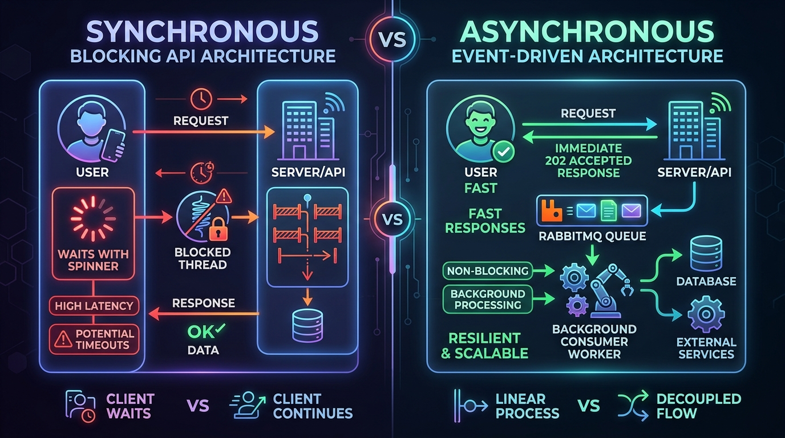
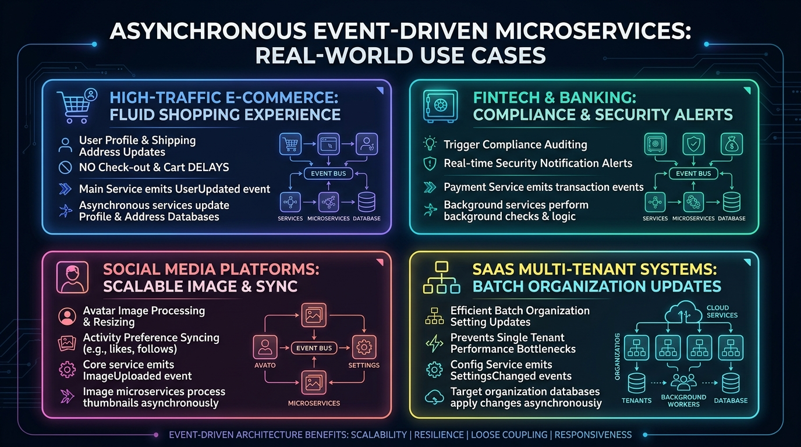
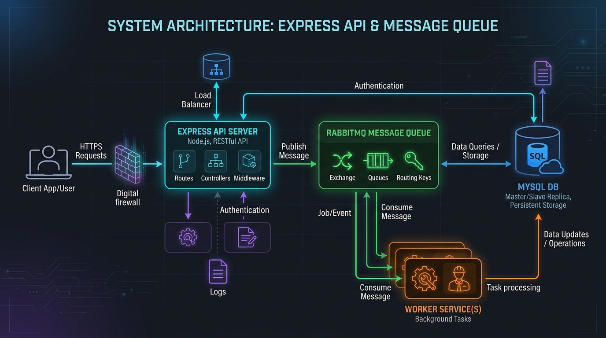

# Asynchronous User Profile Service


A resilient, event-driven backend microservice built with **Node.js**, **Express.js**, **MySQL**, and **RabbitMQ**. It demonstrates high-performance decoupled request processing using the **Repository Pattern** for database abstraction and the **Producer-Consumer Pattern** for non-blocking asynchronous user profile updates.

---

## 💡 What Problem Does This Solve?

In high-concurrency systems, heavy write operations—such as profile updates, third-party syncs, email validations, and audit logs—severely bottleneck synchronous HTTP request-response cycles. Blocking the client thread until database transactions and complex validations complete leads to high latency, thread exhaustion, and cascading request timeouts.

<p align="center">
  
</p>

### Synchronous vs. Asynchronous Architecture:
* **The Synchronous Bottleneck:** In standard synchronous APIs, the client remains blocked with a spinner while the server runs validation queries, checks email uniqueness across the database, and locks records. If traffic surges, request queues back up, leading to `504 Gateway Timeouts`.
* **The Asynchronous Event-Driven Solution:** The API acts as a lightweight producer. It validates the payload structure, publishes an event into a durable RabbitMQ queue, and immediately responds with **`202 Accepted`**. The client continues without delay, while a dedicated background consumer daemon safely processes updates at its own pace.

---

## 🌍 Real-World Use Cases

Event-driven asynchronous user profile updates are foundational across modern distributed systems:

<p align="center">
  
</p>

1. **High-Traffic E-Commerce:** Users can modify profile settings and shipping preferences during flash sales without impacting checkout latency or cart updates.
2. **FinTech & Banking Platforms:** Profile adjustments trigger downstream compliance checks, AML audits, and security notifications asynchronously via decoupled consumers.
3. **Social Networks & Content Platforms:** Avatar resizing, privacy permission syncing, and search index re-indexing run in the background without blocking the user interface.
4. **SaaS Multi-Tenant Platforms:** Tenant-wide organization settings and batch user preference migrations are queued to prevent database lock contention.

---

## 🏗️ System Architecture

The application is orchestrated across four isolated Docker containers within a dedicated bridge network:

<p align="center">
  
</p>

### Architectural Components:
1. **API Service (`api`)**: Express.js REST application handling client authentication, CRUD queries, input validation (Joi), password hashing (bcrypt), and publishing update events to RabbitMQ.
2. **Message Broker (`rabbitmq`)**: RabbitMQ AMQP message broker managing durable queues (`profile_update_queue`) with persistent message delivery guarantees.
3. **Consumer Worker (`consumer`)**: Dedicated Node.js background daemon that subscribes to RabbitMQ, validates data, verifies email uniqueness, and commits persistence updates.
4. **Relational Database (`db`)**: MySQL 8.0 instance automatically initialized with schemas, indexes, and seed records via `init.sql`.

---

## 🔄 End-to-End Execution Flow

```mermaid
sequenceDiagram
    autonumber
    actor Client
    participant API as Express API Server
    participant Broker as RabbitMQ Broker
    participant Consumer as Background Worker
    participant Repo as UserRepository
    participant DB as MySQL Database

    rect rgb(30, 35, 45)
    Note over Client, DB: Synchronous User Profile Creation / Retrieval
    Client->>API: POST /api/users (name, email, password)
    API->>Repo: create(userData)
    Repo->>DB: INSERT INTO users ...
    DB-->>Repo: Saved Record
    Repo-->>API: Sanitized User (no password_hash)
    API-->>Client: 201 Created
    end

    rect rgb(25, 45, 35)
    Note over Client, DB: Asynchronous Profile Update Request Flow
    Client->>API: PUT /api/users/:id/request-update
    API->>API: Validate Joi schema
    API->>Broker: publish('profile_update_queue', payload)
    Broker-->>API: Message Buffered
    API-->>Client: 202 Accepted (Immediate Non-Blocking)
    end

    rect rgb(35, 30, 45)
    Note over Broker, DB: Background Consumer Processing
    Broker->>Consumer: Deliver Message (prefetch: 1)
    Consumer->>Repo: findById(userId)
    Repo->>DB: SELECT * FROM users WHERE id = ?
    Consumer->>Repo: findByEmailExceptUser(email, userId)
    Repo->>DB: SELECT id FROM users WHERE email = ? AND id != ?
    Consumer->>Repo: update(userId, payload)
    Repo->>DB: UPDATE users SET ...
    Consumer->>Broker: channel.ack(msg)
    end
```



---

## 🛡️ Strategic Design Decisions & Architectural Trade-offs

The architectural patterns in this project were chosen to solve the specific bottlenecks of distributed microservices that cannot be conveyed through code alone:

### 1. Message Broker Selection: Why RabbitMQ over Kafka or Redis?
| Technology | Best Suited For | Why RabbitMQ Was Chosen For This Microservice |
| :--- | :--- | :--- |
| **RabbitMQ (AMQP)** | Task Queues & Event-Driven Workers | **Selected.** Provides granular per-message acknowledgments (`ack`/`nack`), durable disk-backed message buffering, and channel prefetching (`prefetch: 1`). Perfect for independent background jobs. |
| **Apache Kafka** | High-Throughput Log Streaming | Overkill for task queues. Requires ZooKeeper/KRaft cluster orchestration, partition key management, and consumers commit offsets in bulk rather than individual message acknowledgment. |
| **Redis Streams / PubSub** | In-Memory Caching & Fast Ephemeral Messaging | While ultra-fast, Redis is fundamentally an in-memory store; RabbitMQ guarantees persistent disk persistence with strict AMQP delivery semantics. |

---

### 2. Concurrency Mechanics: Why `prefetch: 1` Matters
By default, RabbitMQ distributes messages in a round-robin sequence to all active consumers as soon as messages enter the queue. 
* **The Round-Robin Bottleneck:** If Consumer A receives 10 heavy profile updates while Consumer B receives 10 light updates, Consumer A will experience high memory pressure while Consumer B sits idle.
* **The `prefetch: 1` Solution:** In `MessageQueueService.js`, we set `channel.prefetch(1)`. RabbitMQ will only deliver **one message at a time** to a worker container, waiting for an explicit `channel.ack(msg)` before dispatching the next. This guarantees **automatic fair load balancing** across all running worker replicas.

---

### 3. Distributed Failure Modes & Disaster Recovery Matrix

| Scenario / Failure Mode | System Impact | Architectural Mitigation Strategy |
| :--- | :--- | :--- |
| **RabbitMQ Broker Crashes Mid-Transit** | Inflight messages could be lost | Queues are asserted with `{ durable: true }` and published messages carry `{ persistent: true }`, ensuring messages are flushed to disk storage before acceptance. |
| **Worker Daemon Dies During Update** | MySQL write fails or aborts | Because manual acknowledgment (`ack`) is only sent *after* the database commit succeeds, RabbitMQ detects the TCP socket drop and automatically requeues the message for another worker. |
| **Poison Message (Invalid / Corrupted Data)** | Could trigger infinite retry crash loop | The consumer catches domain and validation exceptions, logs structured error diagnostics, and executes `channel.nack(msg, false, false)` to safely discard the unprocessable message without crashing. |
| **Database Unavailable on Container Startup** | Containers crash immediately | `MessageQueueService` and the consumer daemon incorporate an exponential connection retry loop (10 retries with 5s backoff) to gracefully await database and broker readiness. |
| **SIGTERM / Rolling Deployment Restarts** | Dropped in-flight operations | Explicit `SIGINT`/`SIGTERM` process interceptors wait for current task completion, close active AMQP channels, and end the MySQL pool cleanly before process exit. |

---

### 4. Security, Cryptography & Threat Mitigation
* **Password Hashing (Salted bcrypt):** Passwords are never stored in plaintext. They are hashed with 10 salt rounds, rendering rainbow tables and offline brute-force attacks computationally infeasible.
* **SQL Injection Immunity:** All queries inside `UserRepository.js` utilize parameterized query bindings (`?`), fully delegating escaping to MySQL's binary protocol.
* **Information Leak Prevention:** The `password_hash` column is explicitly stripped in all API serialization layers and repository read methods (`create`, `findById`, `findAll`).
* **Container Isolation:** Internal ports for MySQL (`3306`) and RabbitMQ (`5672`) are encapsulated inside the Docker bridge network (`profile-network`) to prevent unauthorized public exposure.

---

### 5. Horizontal Scaling Runbook: Scaling Background Workers
Because RabbitMQ acts as a decoupled message buffer and consumers use `prefetch: 1`, scaling background processing capacity requires **zero code changes**:

To handle 10x write surges, scale the worker container from 1 to 5 instances:
```bash
docker-compose up --scale consumer=5 -d
```
RabbitMQ will immediately distribute queue items across all 5 worker containers simultaneously without race conditions.

---

### 6. Database Design & Indexing Strategy
* **UUID v4 (`CHAR(36)`) vs Auto-Incrementing IDs:** Using random UUIDs prevents ID enumeration attacks (where an adversary queries `/api/users/1`, `/api/users/2` to scrape user data) and allows decentralized ID generation by the API server without waiting for a database sequence lock.
* **Unique B-Tree Index on `email`:** Enables $O(1)$ fast lookups during uniqueness checks (`findByEmailExceptUser`) and provides an ACID-level database safety net against race conditions from concurrent registration requests.
* **Native `JSON` Column for `preferences`:** Rather than rigid schema migrations or unindexed text blobs, MySQL 8.0's native JSON data type validates JSON formatting upon insertion and enables future nested querying using MySQL JSON extract operators.

---

## 📁 Project Structure

```text
Async-User-Profile-Service/
├── .dockerignore
├── .env.example                     // Environment configuration template
├── .gitignore
├── Dockerfile                       // Multi-stage Node.js build for API and Worker
├── docker-compose.yml               // Multi-container orchestration (api, consumer, db, rabbitmq)
├── init.sql                         // Schema definition and initial seed data
├── package.json
├── README.md                        // Project documentation
├── images/                          // Architectural diagrams and infographics
│   ├── system_architecture.png
│   ├── sync_vs_async_flow.png
│   └── real_world_use_cases.png
├── src/
│   ├── api/                         // Express REST Service
│   │   ├── app.js                   // Middleware and routing configuration
│   │   ├── controllers/             // HTTP route controllers
│   │   │   └── userController.js
│   │   ├── routes/                  // API Route definitions
│   │   │   └── userRoutes.js
│   │   └── server.js                // API entrypoint (Port 3000)
│   ├── consumer/                    // Background Consumer Service
│   │   └── index.js                 // Worker daemon entrypoint
│   ├── database/                    // MySQL Connection Pool module
│   │   └── index.js
│   ├── repositories/                // Data Access Layer (Repository Pattern)
│   │   └── UserRepository.js
│   └── services/                    // Business Logic & Queue Adapter
│       ├── MessageQueueService.js   // RabbitMQ Publisher & Consumer abstraction
│       └── ProfileUpdateService.js  // Update coordinator & domain validations
└── tests/                           // Automated Test Suite
    ├── integration/
    │   └── api.test.js              // Dual-mode integration tests
    └── unit/
        └── UserRepository.test.js   // Isolated repository unit tests
```

---

## 🚀 Quick Start Guide

### Prerequisites
- [Docker Desktop](https://www.docker.com/) with Docker Compose installed.
- [Node.js (v18+)](https://nodejs.org/) (optional, only needed for local test runs outside containers).

### 1. Configure Environment
Clone the repository and copy the environment template:
```bash
cp .env.example .env
```

### 2. Launch Multi-Container Environment
Start all four services with a single command:
```bash
docker-compose up --build
```

Once running:
- **API Server:** `http://localhost:3000`
- **Interactive Swagger UI:** `http://localhost:3000/api-docs`
- **RabbitMQ Management UI:** `http://localhost:15672` *(User: `guest` | Password: `guest`)*
- **MySQL Database:** `localhost:3306`

### 3. Graceful Shutdown
To stop containers and clean up internal volumes:
```bash
docker-compose down -v
```

---

## 📡 API Reference

All requests and responses use JSON formatting.

### 1. Create User Profile
* **Method & URL**: `POST /api/users`
* **Status**: `201 Created`
* **Request Body**:
  ```json
  {
    "name": "Sarah Connor",
    "email": "sarah.connor@example.com",
    "password": "StrongPassword123!",
    "preferences": {
      "theme": "dark",
      "notifications": true
    }
  }
  ```
* **Response**:
  ```json
  {
    "id": "e4c3a5e8-1111-4444-9999-666666666661",
    "name": "Sarah Connor",
    "email": "sarah.connor@example.com",
    "preferences": {
      "theme": "dark",
      "notifications": true
    }
  }
  ```

---

### 2. Get All Users (Paginated)
* **Method & URL**: `GET /api/users?page=1&limit=10`
* **Status**: `200 OK`
* **Response**:
  ```json
  {
    "users": [
      {
        "id": "a2c3a5e8-1111-4444-9999-666666666661",
        "name": "Alice Johnson",
        "email": "alice@example.com",
        "preferences": { "theme": "dark", "notifications": true },
        "created_at": "2026-07-16T14:43:29.000Z",
        "updated_at": "2026-07-16T14:43:29.000Z"
      }
    ],
    "total": 4
  }
  ```

---

### 3. Get User by ID
* **Method & URL**: `GET /api/users/:id`
* **Status**: `200 OK` (or `404 Not Found` if user does not exist)
* **Response**:
  ```json
  {
    "id": "a2c3a5e8-1111-4444-9999-666666666661",
    "name": "Alice Johnson",
    "email": "alice@example.com",
    "preferences": { "theme": "dark", "notifications": true },
    "created_at": "2026-07-16T14:43:29.000Z",
    "updated_at": "2026-07-16T14:43:29.000Z"
  }
  ```

---

### 4. Request Asynchronous Profile Update
* **Method & URL**: `PUT /api/users/:id/request-update`
* **Status**: `202 Accepted`
* **Request Body** (optional fields):
  ```json
  {
    "newEmail": "sarah.updated@example.com",
    "newPreferences": {
      "theme": "light",
      "notifications": false
    }
  }
  ```
* **Response**:
  ```json
  {
    "message": "Update request accepted"
  }
  ```
*(Published to RabbitMQ queue `profile_update_queue` and asynchronously committed by the background consumer).*

---

## 🧪 Automated Testing

Automated testing is configured using **Jest** and **Supertest**, featuring:
* **Unit Tests**: Full isolation testing of `UserRepository` query mechanics, mock database calls, and error handling.
* **Dual-Mode Integration Tests**: The test runner checks for live container availability. If live containers are unreachable, it dynamically initializes an in-memory mock store and spies to test all REST routes and asynchronous publication logic without failures.

Run tests locally:
```bash
npm install
npm test
```

Test Results:
```text
PASS tests/integration/api.test.js
PASS tests/unit/UserRepository.test.js
Test Suites: 2 passed, 2 total
Tests:       20 passed, 20 total
```

---

## 🔮 Limitations & Future Improvements

1. **Dead Letter Exchange (DLX / DLQ):**
   * *Current:* Poison messages unhandled by the consumer are discarded with `nack(msg, false, false)`.
   * *Improvement:* Route rejected payloads into a Dead Letter Queue (`profile_update_dlq`) for inspection, telemetry alerts, and automated re-drive.
2. **Distributed Tracing & Correlation IDs:**
   * Inject a unique `correlationId` into the HTTP request headers and RabbitMQ message headers to trace requests seamlessly across microservice boundaries.
3. **WebSockets / SSE Notification:**
   * Implement Server-Sent Events (SSE) or WebSockets to push a real-time notification back to the client application once the asynchronous background update finishes committing to MySQL.
